Mermaid 能把 Markdown 中的文字描述转成图表。下面的示例沿用 Shirone 的内容工作流，演示技术文章与项目笔记中常用的各类图表。

## 流程图

流程图描述一个过程，包括判断分支以及返回到先前步骤的路径。

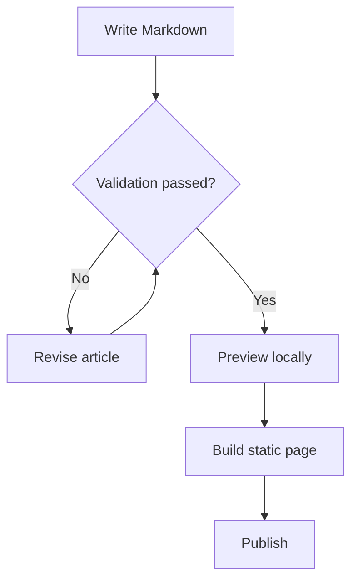

## 时序图

时序图按时间顺序呈现参与者之间的协作。本例跟随一次 Swup 导航，从发起请求一直到 Mermaid 完成渲染。

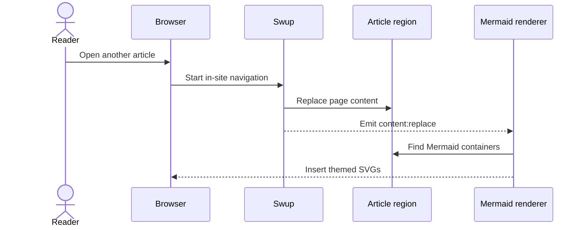

## 实体关系图

实体关系图为结构化数据建模，并刻画作者、文章、标签与评论之间的关联。

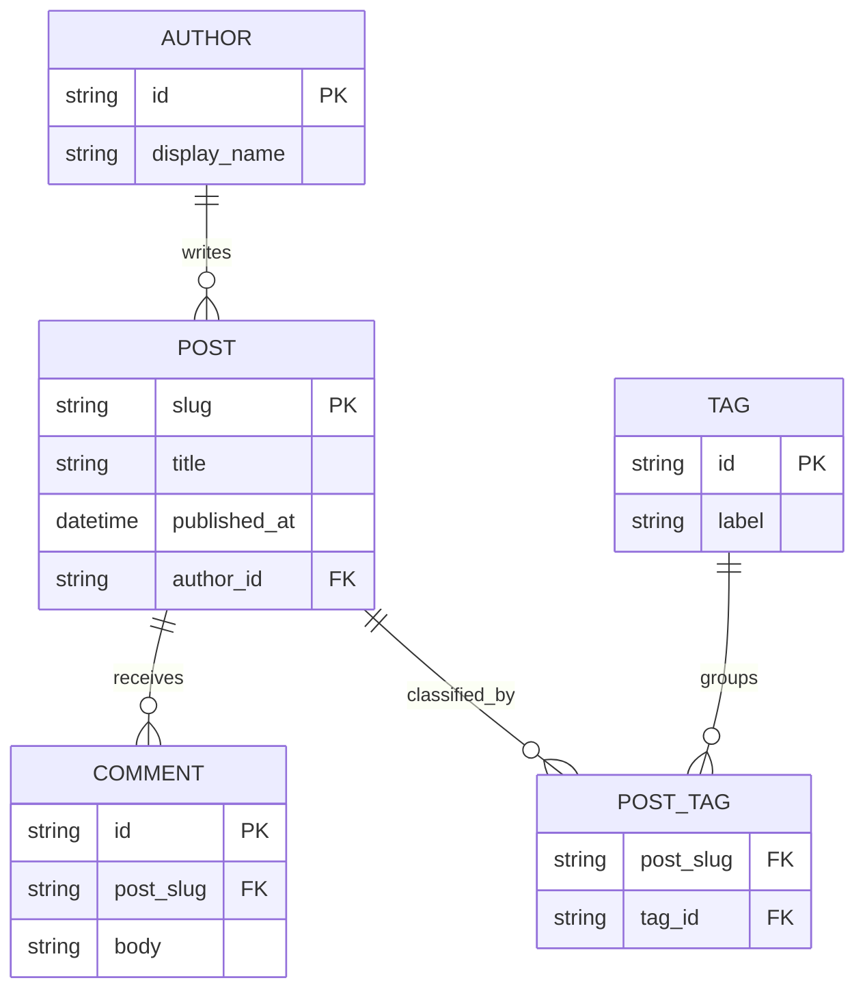

## 类图

类图表达软件设计中的职责、公开方法与依赖方向。

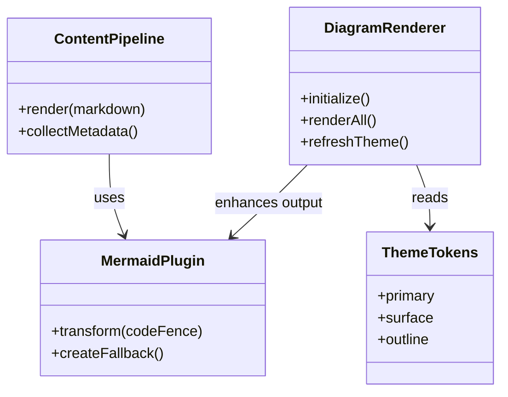

## 状态图

状态图展示对象的生命周期，以及让它在各状态之间迁移的事件。

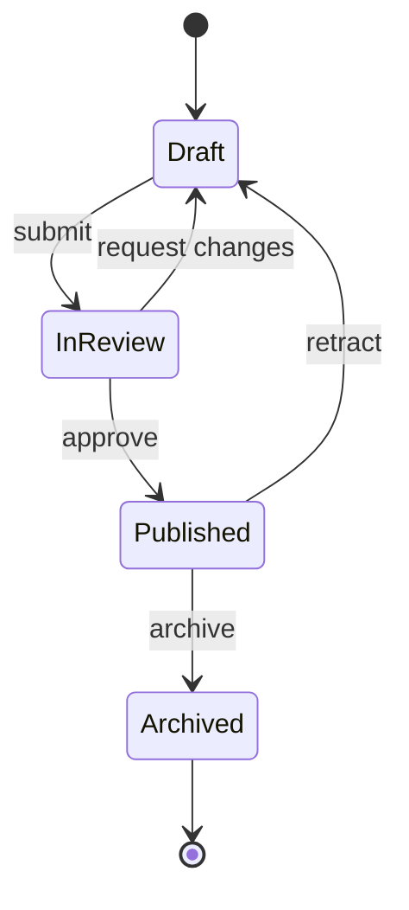

## XY 图

XY 图把柱状与折线组合在共用坐标轴上，用来比较数值与趋势。

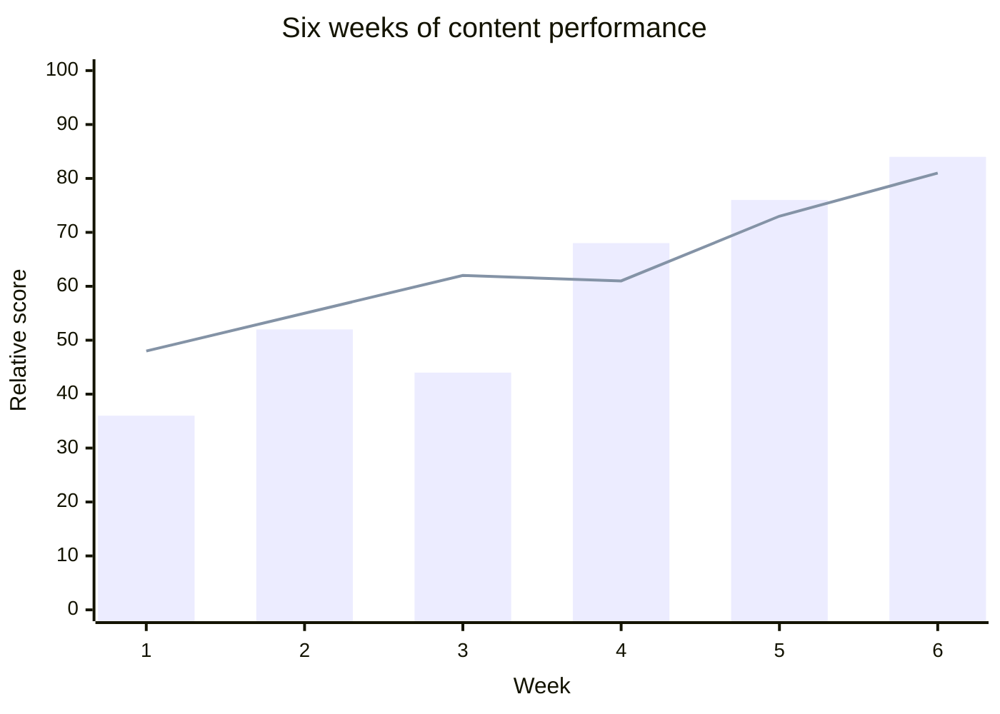

## 饼图

饼图以紧凑的方式比较各类别对整体的贡献。

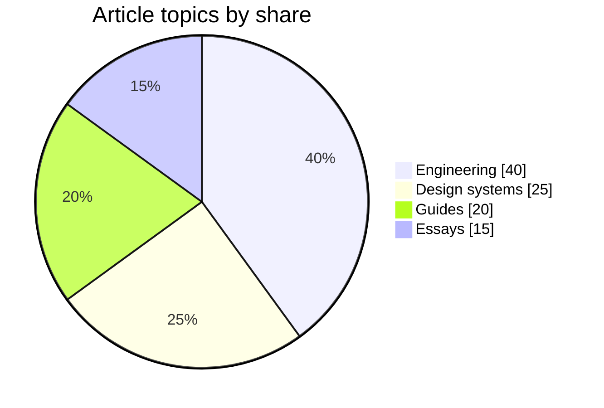

## 甘特图

甘特图沿日历时间轴安排任务、依赖关系与里程碑。

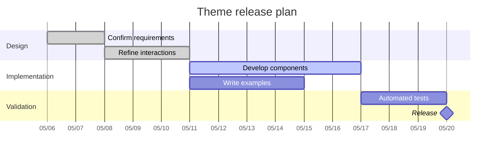

## 思维导图

思维导图把中心主题展开为相关领域与支撑概念。

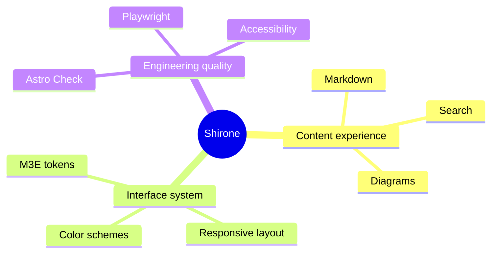

## 时间线

时间线归纳重要事件或阶段，无需精确的日历工期。

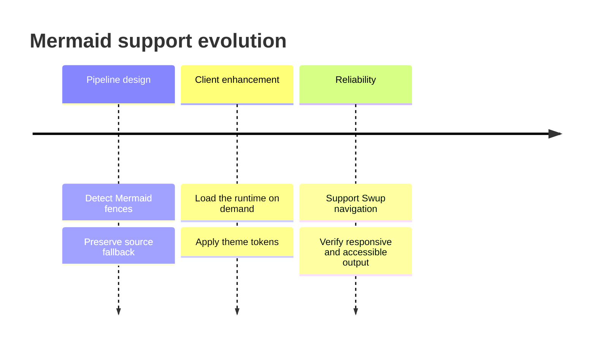

## 用户旅程

用户旅程图把任务各阶段中的动作、参与者与体验评分组合起来。

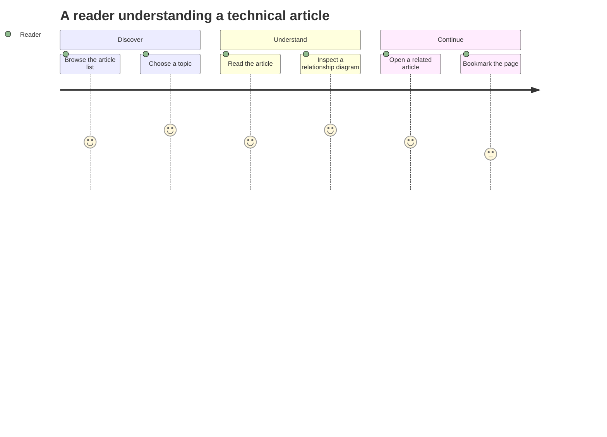

## Git 图

Git 图展示特性分支上的工作如何推进，直至合并回主线。

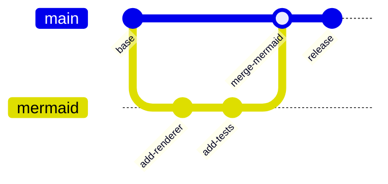

## 看板

看板按工作流状态对任务分组，让当前进度一目了然。

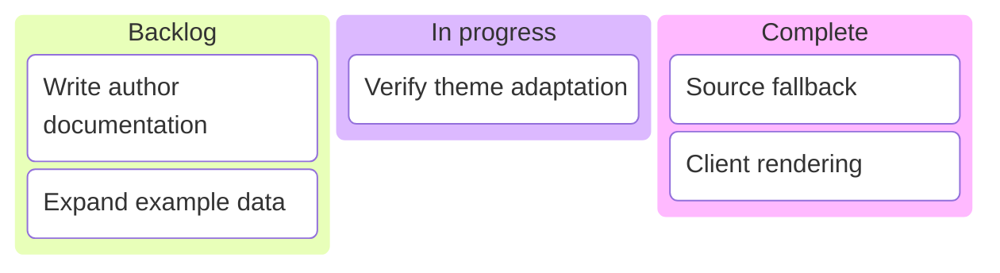

## 桑基图

桑基图用连线宽度表示流量或其他数量在节点之间的流动。

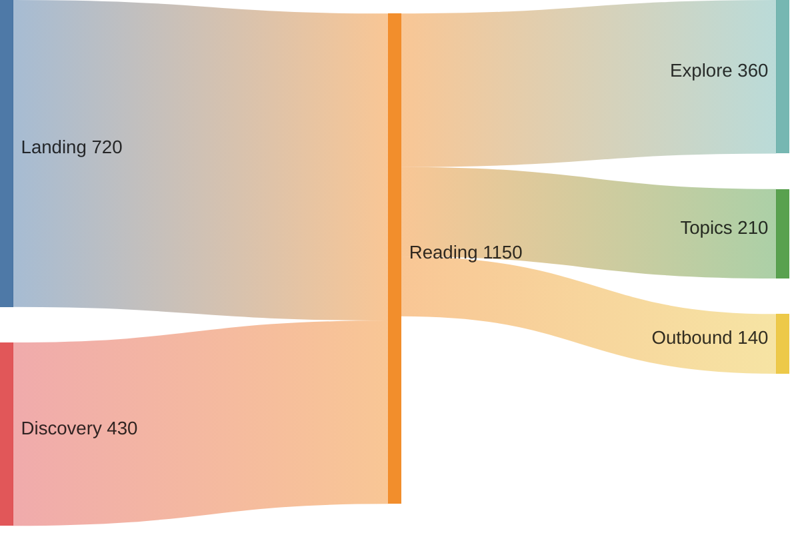

## 标签中的换行

HTML 标签支持换行，因此标签可以折行而不撑宽图表。

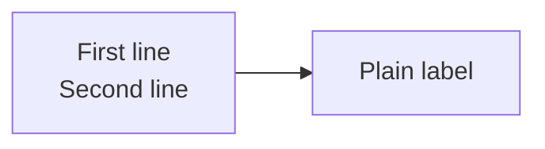

每个示例都使用标准的 `mermaid` 代码围栏。服务端保留可读的源码标记，浏览器再把它增强为跟随当前主题的 SVG。主题切换或 Swup 导航到本文时，图表会重新渲染。